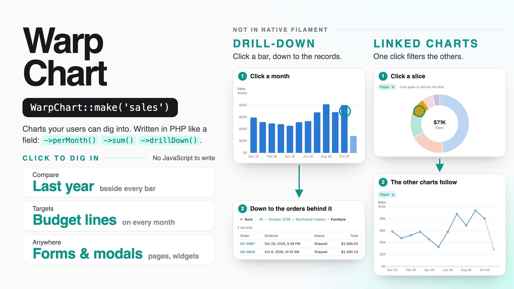
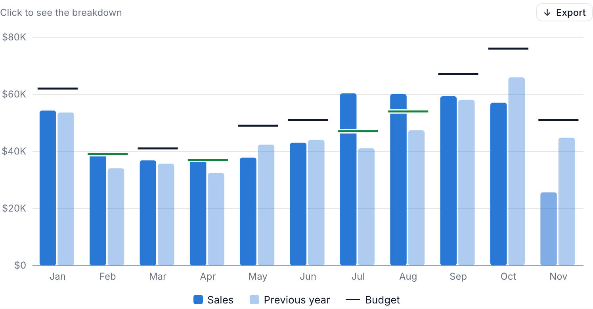
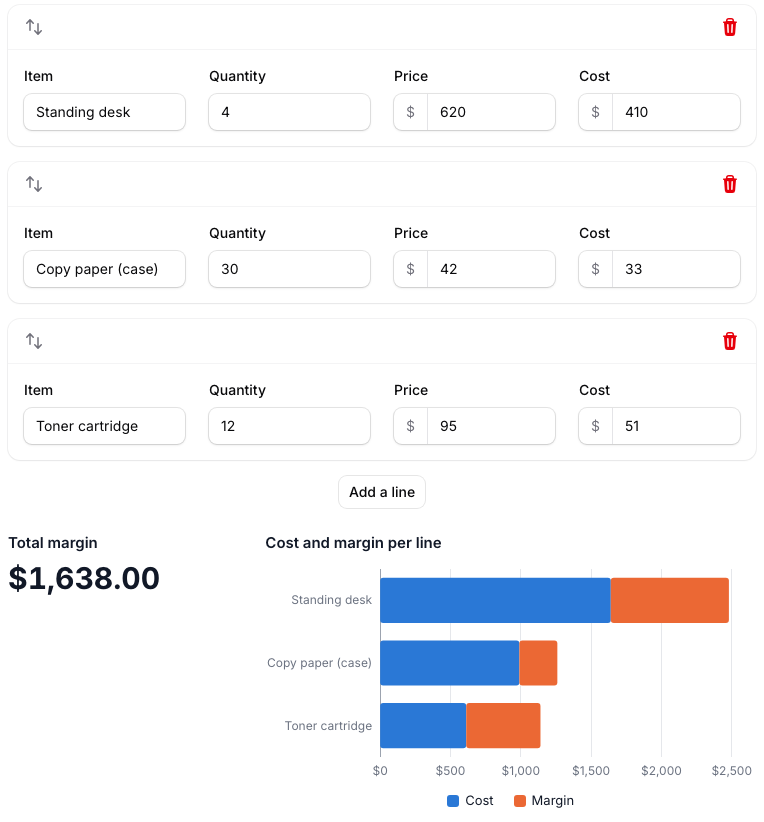
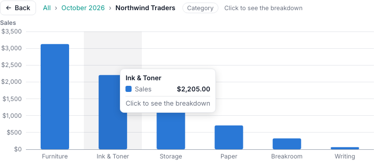
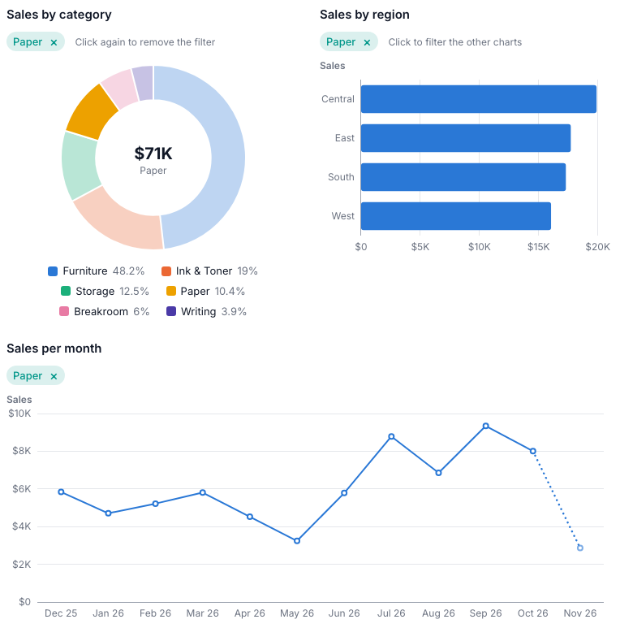

# Warp Chart

**Charts for Filament that people can dig into. Put a chart in a form, a page, a widget or the modal of a table action; click a bar to see what is behind it, down to the records; compare with last year; draw the budget as a line; and let a click in one chart filter the others. You write the chart in PHP, next to your fields — there is no dashboard builder to learn and no JavaScript to write.**

<a href="https://demo.warpui.com/chart"></a>

Click a month to see its customers, then a customer, down to the orders; click a slice of a donut and watch the other charts follow; type a quote and watch the margin chart move — at **[demo.warpui.com/chart](https://demo.warpui.com/chart)**. No sign-up needed; the data is reset every hour.



- [What it does](#what-it-does)
- [Installation](#installation)
  - [AI coding assistants (Laravel Boost)](#ai-coding-assistants-laravel-boost)
- [A first chart](#a-first-chart)
- [Where a chart can go](#where-a-chart-can-go)
  - [Forms and infolists](#forms-and-infolists)
  - [Widgets](#widgets)
  - [Action modals: table rows, selected rows, the filtered table](#action-modals-table-rows-selected-rows-the-filtered-table)
- [Charts from an Eloquent query](#charts-from-an-eloquent-query)
  - [Grouping](#grouping)
  - [What to measure](#what-to-measure)
  - [Period and timezone](#period-and-timezone)
  - [Top values and split series](#top-values-and-split-series)
- [Charts from your own data](#charts-from-your-own-data)
  - [In the browser, without asking the server](#in-the-browser-without-asking-the-server)
- [Charts from a Warp Pivot](#charts-from-a-warp-pivot)
- [Drill-down](#drill-down)
- [Comparing with last year or the previous period](#comparing-with-last-year-or-the-previous-period)
- [Budget and target lines](#budget-and-target-lines)
- [Filters that every chart follows](#filters-that-every-chart-follows)
- [Linked charts](#linked-charts)
- [Chart types and appearance](#chart-types-and-appearance)
- [Export](#export)
- [Loading data later](#loading-data-later)
- [Panel settings](#panel-settings)
- [Multi-tenancy](#multi-tenancy)
- [Security](#security)
- [Accessibility](#accessibility)
- [Testing](#testing)
- [Requirements](#requirements)
- [Support](#support)
- [License](#license)

## What it does

| You want… | Use |
| --- | --- |
| A chart next to the fields of a form, in an infolist or on a page | [`WarpChart`](#a-first-chart) |
| A chart on the dashboard that follows the dashboard filters | [`WarpChartWidget`](#widgets) |
| *Sales of this customer* from a table row, in a modal | [`WarpChartAction`](#action-modals-table-rows-selected-rows-the-filtered-table) |
| A chart of exactly the rows the table shows after filtering and searching | [`->tableQuery()`](#action-modals-table-rows-selected-rows-the-filtered-table) |
| Sales per month from your orders, without writing SQL | [`->query()->perMonth()->sum()`](#charts-from-an-eloquent-query) |
| Click a month → customers → categories → the orders | [`->drillDown()`, `->drillToRecords()`](#drill-down) |
| This year next to last year | [`->compareToPreviousYear()`](#comparing-with-last-year-or-the-previous-period) |
| The budget as a line over the bars | [`->target()`](#budget-and-target-lines) |
| A date range that every chart on the page follows | [`->period(fn (Get $get) => …)`](#filters-that-every-chart-follows) |
| Click a category in one chart, see the others narrow down | [`->selectable()`, `->reactsTo()`](#linked-charts) |
| The chart as an image, a CSV file or a PDF | [`->exportable()`](#export) |
| A chart of a pivot you already defined in Warp Pivot | [`->pivot()`](#charts-from-a-warp-pivot) |
| A margin chart that changes as someone types a quote | [`->data(fn (Get $get) => …)`](#charts-from-your-own-data) |

Every chart:

- **is redrawn when its data changes.** Each time Livewire renders the page, the chart gets its data again and redraws. A filter never leaves an old chart on the screen.
- **works where forms live:** in tabs that start hidden, in modals and slide-overs, in repeaters, on create and edit pages, in relation managers, in widgets, and in SPA mode. A chart is drawn when it becomes visible, at the width it really has.
- **gives the same numbers on SQLite, MySQL, MariaDB and PostgreSQL.** Days, weeks and months are cut in the viewer's timezone, also across daylight saving changes.
- **has no chart library inside.** It draws its own SVG, so a Filament or library update cannot make your charts disappear, and there is no license to check.
- **follows light and dark mode, the width of a phone, the keyboard and screen readers.**
- **speaks ten languages** (English, Japanese, German, French, Spanish, Italian, Brazilian Portuguese, Korean, simplified and traditional Chinese). Numbers, currencies and month names follow the language of the viewer.

Warp Chart is for developers who build the analysis screens of their app in code. It does not let your users assemble their own dashboards.

## Installation

> **Warp Chart is a commercial plugin.** A license is required. After purchase you receive credentials for the private Composer repository.

```bash
composer config repositories.qalainau composer https://qalainau.privato.pub/composer
composer config --auth http-basic.qalainau.privato.pub "your-email" "your-license-key"

composer require qalainau/filament-warp-chart
php artisan filament:assets
```

There is nothing to publish and no migration: Warp Chart has no tables of its own. Registering the plugin on a panel is optional and only needed for [panel settings](#panel-settings):

```php
use Qalainau\FilamentWarpChart\FilamentWarpChartPlugin;

$panel->plugin(FilamentWarpChartPlugin::make()->currency('USD'));
```

Run `php artisan filament:assets` again after each update of the plugin.

### AI coding assistants (Laravel Boost)

Warp Chart ships instructions for AI coding assistants such as Claude Code, Cursor and Codex. If your app uses
[Laravel Boost](https://laravel.com/docs/boost), the assistant learns from them to reach for `WarpChart` instead of writing Chart.js code or SQL for date buckets, how to add drill-down, comparisons and linked charts, and how to test a chart.

- **Guidelines** (`resources/boost/guidelines/core.md`): a short summary that Boost adds to `CLAUDE.md`, `AGENTS.md` and the other agent files. It also points the assistant to this README in `vendor/`, so it reads the documentation of the version you have installed.
- **Skill** `warp-chart-development` (`resources/boost/skills/`): an example for every part, and tests. The assistant loads it when it works on charts.

When `php artisan boost:install` asks "Which third-party AI guidelines/skills would you like to install?", select `qalainau/filament-warp-chart`. To do it without the question, add the package to `boost.json` and run the command again:

```json
{
    "packages": ["qalainau/filament-warp-chart"]
}
```

```bash
php artisan boost:install --guidelines --skills -n
```

## A first chart



`WarpChart` is a schema component. Put it where you put fields, sections and entries:

```php
use App\Models\Order;
use Qalainau\FilamentWarpChart\WarpChart;

WarpChart::make('sales')
    ->heading('Sales per month')
    ->bar()
    ->money('USD')
    ->query(Order::class)
    ->perMonth('ordered_at')
    ->sum('total', 'Sales')
    ->period(now()->startOfYear(), now())
```

The name (`'sales'`) must be unique among the charts of one schema. It is how the browser finds the chart when it asks for more data.

## Where a chart can go

### Forms and infolists



In the form or infolist of a resource, `->relationship()` reads a relationship of the record on the screen:

```php
public static function form(Schema $schema): Schema
{
    return $schema->components([
        TextInput::make('name'),

        Section::make('Sales to this customer')->schema([
            WarpChart::make('sales')
                ->bar()->money('USD')
                ->relationship('orders')          // $record->orders()
                ->perMonth('ordered_at')
                ->sum('total', 'Sales'),
        ]),
    ]);
}
```

On the create page there is no record yet; the chart then says there is no data. Hide it there if you prefer: `->visibleOn('edit')`.

All closures of a chart get Filament's usual arguments: `Get $get`, `$record`, `$livewire`, `$operation`. See [Charts from your own data](#charts-from-your-own-data) for a chart that follows the fields as someone types.

### Widgets

```php
use Qalainau\FilamentWarpChart\WarpChart;
use Qalainau\FilamentWarpChart\Widgets\WarpChartWidget;

class SalesThisYear extends WarpChartWidget
{
    protected ?string $heading = 'Sales this year';

    protected int|string|array $columnSpan = 'full';

    protected function chart(WarpChart $chart): WarpChart
    {
        return $chart->bar()->money('USD')
            ->query(Order::class)
            ->perMonth('ordered_at')
            ->sum('total', 'Sales')
            ->period(fn (): array => [$this->pageFilters['from'] ?? now()->startOfYear(), $this->pageFilters['until'] ?? now()]);
    }
}
```

`$this->pageFilters` holds the filters of a dashboard that uses Filament's `HasFiltersForm` or `HasFiltersAction`. When they change, the widget renders again and the chart redraws.

### Action modals: table rows, selected rows, the filtered table

`WarpChartAction` opens a chart in a modal (`->slideOver()` for a slide-over). The data is fetched when the modal opens, not when the table is rendered.

```php
use Qalainau\FilamentWarpChart\Actions\WarpChartAction;
use Qalainau\FilamentWarpChart\Actions\WarpChartBulkAction;

$table
    ->recordActions([
        // One row: the orders of that customer
        WarpChartAction::make('sales')
            ->label('Sales')
            ->modalHeading(fn (Customer $record) => "Sales to {$record->name}")
            ->chart(fn (WarpChart $chart) => $chart->bar()->money('USD')
                ->relationship('orders')->perMonth('ordered_at')->sum('total', 'Sales')),
    ])
    ->headerActions([
        // The table as it is now: filters and search applied
        WarpChartAction::make('byRegion')
            ->label('Customers by region')
            ->chart(fn (WarpChart $chart) => $chart->donut()
                ->tableQuery()->groupBy('region')->count('Customers')),
    ])
    ->toolbarActions([
        // The selected rows
        WarpChartBulkAction::make('compare')
            ->label('Compare sales')
            ->chart(fn (WarpChart $chart, Collection $records) => $chart->bar()->horizontal()->money('USD')
                ->query(fn () => Order::query()->whereIn('customer_id', $records->modelKeys()))
                ->groupByRelation('customer')->sum('total', 'Sales')),
    ]);
```

- The closure of `->chart()` receives the chart and the usual arguments of an action (`$record`, `$records`, `$livewire`).
- `->tableQuery()` charts the query of the table with its current filters and search, so the chart counts exactly the rows the list shows. It works on list pages, relation managers and table widgets.
- The chart inside the modal is named `<action name>Chart`.
- Any other action can show a chart too: `Action::make('report')->schema([WarpChart::make('…')…])`.

## Charts from an Eloquent query

`->query()` takes a model class, a builder, a relationship, or a closure that returns one of them:

```php
->query(Order::class)
->query(fn () => Order::query()->where('status', '!=', 'cancelled'))
->query(fn (Get $get) => Order::query()->when($get('region'), fn ($query, $region) => $query->whereRelation('customer', 'region', $region)))
```

Global scopes (soft deletes, your own) stay in effect. Ordering and eager loads of the query are dropped for the aggregation. If the closure returns `null`, the chart shows “No data to show”.

### Grouping

| Method | Groups by |
| --- | --- |
| `->perDay('ordered_at')`, `->perWeek()`, `->perMonth()`, `->perQuarter()`, `->perYear()` | a date column |
| `->groupBy('status')` | the values of a column |
| `->groupBy('status', ['open' => 'Open', 'won' => 'Won'])` | the same, with your labels, in your order |
| `->groupByRelation('customer', 'name')` | a `BelongsTo`; the labels come from the related model |

- Date charts list every day, week or month of the period, with zero where there are no records.
- The day, week or month that is not over yet is drawn paler, and its tooltip says so, so the current month does not look like a drop. The small trend line of a number leaves it out.
- A column that is cast to an enum gets its labels from `getLabel()` (or the case names), in the order of the cases.
- Without given labels, values are sorted from the largest to the smallest. Records without a value come last as “(none)”.
- `groupByRelation()` groups by the foreign key and reads only the names it needs, also of soft-deleted records.

The same groupings exist as objects, for [drill-down](#drill-down) levels and when you need more control:

```php
use Qalainau\FilamentWarpChart\Query\Dimension;

Dimension::date('ordered_at')->perWeek()
Dimension::make('status')->labels([...])->label('Status')
Dimension::relation('customer', 'name')->label('Customer')
```

### What to measure

```php
->count('Orders')
->sum('total', 'Sales')
->average('total', 'Average order')
->min('total')
->max('total')
```

The second argument is the name shown in the legend and the tooltip. Call several to draw several series. Without any, the chart counts the records.

### Period and timezone

```php
->period('2026-01-01', '2026-12-31')
->period(fn (Get $get) => [$get('from'), $get('until')])
```

Both days are included. Without a period, a date chart covers the range of the records it finds. A closure may return `null`, or an unfinished date while someone types; the chart then uses no period.

A chart that is not grouped by date needs to know which column the period applies to:

```php
->groupBy('status')->count()
->periodColumn('ordered_at')
->period($from, $until)
```

Days, weeks and months are cut in the timezone of the viewer: `->timezone('America/New_York')` on the chart, `timezone()` on the [plugin](#panel-settings), or `config('app.timezone')`. An order stored at 03:30 UTC on 1 November counts for 31 October in New York. This stays correct across daylight saving changes. Columns cast as `date` have no time and are never shifted; if your date column has no cast, say so: `Dimension::date('delivery_date')->dateOnly()`.

Weeks start on Monday. Change that with `->weekStartsOn(0)` (Sunday) on the chart or the plugin.

### Top values and split series

```php
->groupByRelation('customer')->sum('total')->top(10)                    // the ten largest and “Other”
->groupByRelation('customer')->sum('total')->top(10, withOther: false)  // only the ten largest
->top(10, 'All others')                                                 // your name for the rest

->perMonth('ordered_at')->sum('total')->splitBy('category')->stacked()  // one series per category
```

`splitBy()` uses the first measure and draws up to eight series, the largest first; the rest becomes “Other”. “Other” is always drawn in gray.

## Charts from your own data

When the numbers do not come from one query — an API, a calculation, the fields of the form — return them from `->data()`:

```php
use Qalainau\FilamentWarpChart\Data\ChartData;

WarpChart::make('margin')
    ->bar()->stacked()->horizontal()->money('USD')
    ->data(fn (Get $get) => ChartData::make()
        ->labels(collect($get('lines'))->pluck('item')->all())
        ->series('Cost', collect($get('lines'))->map(fn ($line) => $line['quantity'] * $line['cost'])->all())
        ->series('Margin', collect($get('lines'))->map(fn ($line) => $line['quantity'] * ($line['price'] - $line['cost']))->all()))
```

Make the fields `->live()` (a debounce is kind to the server: `->live(debounce: 400)`), and the chart follows as someone types.

`ChartData`:

| Method | |
| --- | --- |
| `->labels(['Jan', 'Feb'])` | The categories. With `['jan' => 'January']` the key (sent to the server on a click) and the label differ. |
| `->series('Sales', [10, 20])` | A series, in the order of the labels or keyed by category key. `type: 'line'` draws this one as a line over bars; `color: '#0ea5e9'` fixes its color. |
| `->compare('Last year', [8, 9])` | A comparison series, drawn lighter next to the main one. |
| `->target(15, 'Budget')` | A horizontal line. Pass an array for a target per category. |
| `->drillable()` | Lets people click a category; see below. |
| `->records($columns, $rows, $total)` | Shows a list instead of a chart (the end of a drill-down). |

The array of Filament's chart widget works as well, so an existing `getData()` can be moved over as it is:

```php
->data(['labels' => ['Jan', 'Feb'], 'datasets' => [['label' => 'Sales', 'data' => [10, 20]]]])
```

### In the browser, without asking the server

When the numbers are only a calculation over the fields of the form, `->js()` works them out in the browser. The chart follows every keystroke, and the fields do not need to be `->live()`:

```php
TextInput::make('quantity')->numeric(),
TextInput::make('price')->numeric(),
TextInput::make('cost')->numeric(),

WarpChart::make('margin')
    ->bar()->money('USD')
    ->js(<<<'JS'
        (() => {
            const quantity = Number($get('quantity')) || 0
            const price = Number($get('price')) || 0
            const cost = Number($get('cost')) || 0

            return {
                labels: ['Revenue', 'Cost', 'Margin'],
                series: [{ label: 'Quote', values: [quantity * price, quantity * cost, quantity * (price - cost)] }],
            }
        })()
    JS)
```

- The expression is JavaScript and returns `{ labels: [...], series: [{ label, values }] }`. A series may also have `type` (`'bar'`, `'line'`, `'area'`) and `color`.
- `$get('field')` reads the current value of a field of the same form, like Filament's `Get`. A repeater is an object of `key => row`; use `Object.values($get('lines') ?? {})`.
- The type, the format, target lines and colors still come from the PHP methods. Drill-down, comparisons and linked charts need the server and do not apply.
- The expression is your code and is printed into the page. Never build it from user input; read values with `$get()`.

To drill down through your own data, mark the data `->drillable()` and read where the viewer is from the request:

```php
use Qalainau\FilamentWarpChart\ChartRequest;

->data(function (ChartRequest $request): ChartData {
    if ($request->depth() === 0) {
        return ChartData::make()->labels(['north' => 'North', 'south' => 'South'])->series('Stores', [12, 7])->drillable();
    }

    $region = $request->drillKey(0);   // 'north' or 'south' — comes from the browser, validate it

    return ChartData::make()->labels(...)->series(...);
})
```

## Charts from a Warp Pivot

If the app also uses [Warp Pivot](https://warpui.com), a chart can draw a pivot as it is. The rows, columns, values, filters, permissions and tenant scope are the ones of the pivot, so they are defined once:

```php
WarpChart::make('sales')
    ->bar()->stacked()->money('USD')
    ->pivot(SalesByRegion::class)                          // a PivotPage or PivotWidget class

WarpChart::make('median')
    ->pivot(SalesByRegion::class, measure: 'amount_median')  // one value of the pivot, by name

WarpChart::make('here')
    ->pivot(fn ($livewire) => $livewire->getWarpPivot())   // a closure that returns the Pivot
```

- The row headings of the pivot are the categories. Its column headings are the series; a pivot without columns gives one series per value.
- A pivot with more than one row level can be drilled into: a click opens the next row level, with the usual path and Back button.
- Values that only the pivot has — medians, ratios, formulas, distinct counts — can be charted this way.
- Given a class, the pivot is built without mounting the component: its filters have their default values, and a `pivot()` that depends on `mount()` arguments cannot be used. Pass a closure when the chart sits in the component that has the pivot.
- Needs Warp Pivot 1.8 or later. Warp Chart does not require Warp Pivot; without it, do not call `->pivot()`.

## Drill-down



For query charts, list how each click should break the numbers down:

```php
use Qalainau\FilamentWarpChart\Query\Dimension;
use Qalainau\FilamentWarpChart\Query\RecordColumn;

WarpChart::make('sales')
    ->bar()->money('USD')
    ->query(Order::class)
    ->perMonth('ordered_at')
    ->sum('total', 'Sales')
    ->drillDown(
        Dimension::relation('customer', 'name')->label('customer'),
        Dimension::make('category')->label('category'),
    )
    ->drillToRecords(
        ['number' => 'Order', 'customer.name' => 'Customer', 'ordered_at' => 'Ordered', RecordColumn::make('total')->money('USD')],
        url: fn (Order $record) => OrderResource::getUrl('view', ['record' => $record]),
    )
```

A click on November shows November by customer; a click on a customer shows that customer's November by category; a click on a category lists the orders. A **Back** button and a path (*All › November 2026 › Acme*) lead back up. The `->label()` of a level is shown next to the path (*by customer*).

- `->drillDown()` takes any number of levels. A string is a column: `->drillDown('category', 'status')`. Date levels work too: `->perMonth('ordered_at')->drillDown(Dimension::date('ordered_at')->perDay())` goes from a month to its days.
- `->drillToRecords($columns, $url, $limit)` ends the drill-down with a list of records, newest first (or in the order of your query). Columns are attribute names (`'customer.name'` follows relationships and eager loads them), `name => heading` pairs, or `RecordColumn` objects with `->label()`, `->money()`, `->numeric()` and `->formatStateUsing(fn ($state, $record) => …)`. Only the columns you list are sent to the browser. The list shows up to `$limit` records (50 by default, 500 at most) and says how many there are in total.
- With `$url`, the first column links to the record. Only paths inside the site and `http(s)` URLs are accepted.
- The comparison follows down the levels; target lines are shown on the first level only.
- “Other” (from `->top()`) cannot be clicked.

The position in the drill-down lives in the browser. When the page is rendered again — a filter changed, the form was saved — the chart stays on its level and fetches that level again.

## Comparing with last year or the previous period

```php
->period($from, $until)
->compareToPreviousYear()               // the same days one year earlier
->compareToPreviousPeriod()             // the period of the same length just before
->compareToPreviousYear('Last year')    // your label
```

The comparison is drawn lighter next to the bars (dashed for lines), and the tooltip shows the change: *+18.1% vs Previous year*. A [number](#chart-types-and-appearance) shows the change under the total. A comparison needs a period.

- A period of whole months moves by months (November → October), any other period by its number of days.
- With weekly buckets, “previous year” means 52 weeks earlier, so weekdays line up.
- To let people choose: `->compare(fn (Get $get) => Comparison::tryFrom((string) $get('compare')))` with `Qalainau\FilamentWarpChart\Enums\Comparison` (`PreviousYear`, `PreviousPeriod`); `null` draws no comparison.

## Budget and target lines

```php
->target(120_000, 'Budget')                                   // one line across the chart
->target(fn () => Budget::pluck('amount', 'month')->all())    // a mark per category: ['2026-11' => 120000, …]
->target(fn (Get $get) => $get('goal'), 'Goal')
```

- A number draws a dashed line with its label. An array draws a mark on each category; its keys are the category keys — for date charts `2026-11-03` (day), `W2026-11-02` (week, by its first day), `2026-11` (month), `2026-Q4` (quarter) and `2026` (year).
- The tooltip shows the share reached: *93% of Budget ($120,000.00)*. A number chart shows a progress bar.
- Call `->target()` more than once for several lines.

## Filters that every chart follows

A chart reads the form it sits in through `Get $get`. Put live fields above the charts, and every chart that reads them is fetched again when they change:

```php
public function content(Schema $schema): Schema
{
    $orders = fn (Get $get) => Order::query()->when($get('status'), fn ($query, $status) => $query->where('status', $status));
    $period = fn (Get $get) => [$get('from'), $get('until')];

    return $schema->statePath('data')->components([
        DatePicker::make('from')->live(),
        DatePicker::make('until')->live(),
        Select::make('status')->options(OrderStatus::class)->live(),

        WarpChart::make('sales')->query($orders)->perMonth('ordered_at')->sum('total')->period($period),
        WarpChart::make('customers')->query($orders)->groupByRelation('customer')->sum('total')->periodColumn('ordered_at')->period($period),
    ]);
}
```

There is nothing to wire up and no event to dispatch: the charts are part of the page, so they are rendered with it. On dashboards, widgets read `$this->pageFilters` the same way.

## Linked charts



```php
// Clicking a slice selects that category…
WarpChart::make('byCategory')
    ->donut()
    ->selectable('category')
    ->query(Order::class)->groupBy('category')->sum('total'),

// …and this chart is fetched again with it
WarpChart::make('monthly')
    ->reactsTo('category')
    ->query(fn (ChartRequest $request) => Order::query()
        ->when($request->selection('category'), fn ($query, $category) => $query->where('category', $category)))
    ->perMonth('ordered_at')->sum('total'),
```

- `->selectable('name')` makes a click publish the clicked key under that name. The clicked mark stays strong and the others fade. Clicking it again clears the selection. A donut shows the selected value in its middle.
- `->reactsTo('name')` (or an array of names) makes a chart fetch its data again when that selection changes. The selection is in `$request->selection('name')`, or `null`. A chart only receives the selections it reacts to.
- The chart that was clicked and every chart that reacts show the current selection as a badge with a × to clear it.
- A chart can be both: `->selectable('region')->reactsTo('category')`.
- A selectable chart does not drill down on click.
- Charts in different Livewire components (widgets, a modal) on the same page are linked as well.

Other components can follow a selection through the Livewire event `warp-chart-selected`:

```php
#[On('warp-chart-selected')]
public function filterTable(string $name, ?string $key, ?string $label): void
{
    if ($name === 'category') {
        $this->tableFilters['category']['value'] = $key;
    }
}
```

Selections come from the browser. Use them as values in queries, as above; do not use them to decide what someone may see.

## Chart types and appearance

| Method | |
| --- | --- |
| `->bar()` | Bars (the default). `->horizontal()` for long names and rankings, `->stacked()` to stack the series. |
| `->line()` | Lines. Gaps where there is no value. |
| `->area()` | Filled lines; `->stacked()` stacks them. |
| `->pie()`, `->donut()` | The first series as shares. The donut shows the total in the middle; the legend shows the percentages. |
| `->stat()` | A big number: the sum of the first series, the change against the comparison, progress towards the target, and a small trend line. |
| `->type(fn (Get $get) => $get('type'))` | Choose the type at runtime (`'bar'`, `'line'`, `'area'`, `'pie'`, `'donut'`, `'stat'` or the `ChartType` enum). |

Bars and a line in one chart: give one series its own type in `ChartData`: `->series('Cancelled', [...], type: 'line')`.

| Method | |
| --- | --- |
| `->heading('Sales')`, `->description('…')` | Text above the chart. Inside a `Section` you usually do not need them. |
| `->height(320)` | Height in pixels (280 by default). The width follows the container. |
| `->money('USD')`, `->numeric(1)`, `->percent()` | How values are written. `money()` without a currency uses the plugin's `currency()`. `percent()` expects 0–100. |
| `->prefix('~')`, `->suffix(' h')` | Text around every value. |
| `->valueLabel('Orders')` | The name of the value axis, shown small at the top left. Without it, a chart with a single series shows the name of that series, and a number without a heading shows it above the number. `->valueLabel(false)` hides it. |
| `->dataLabels()` | Write each value at the end of its bar or above its point, in the short form of the axis (`$42K`). For bars that are not stacked and for lines, where the text fits. |
| `->hints(false)` | Hide the one-line hint above a chart that can be clicked (“Click to see the breakdown”, “Click to filter the other charts”). |
| `->legend(false)` | Hide the legend (shown by default when there is more than one series). Clicking a legend entry hides that series. |
| `->colors(['#0ea5e9', '#f97316'])` | Series colors, in order. The default eight colors differ for light and dark mode and are ordered to stay distinguishable for color-blind viewers. |
| `->colors(['Paper' => '#eda100', 'Ink' => '#1baf7a'])` | Colors by name: the key or label of a series (of a category in a pie). A category then has the same color in every chart, whatever the order. Names that are not listed get the colors in order. |

Colors can also be set with CSS, for both modes:

```css
.fi-warp-chart { --fi-warp-chart-c1: #0ea5e9; --fi-warp-chart-c2: #f97316; }
.dark .fi-warp-chart { --fi-warp-chart-c1: #38bdf8; }
```

## Export

```php
WarpChart::make('sales')->exportable()                 // image, data and print
WarpChart::make('sales')->exportable(['csv'])          // only the data
WarpChart::make('sales')->exportable(fn () => auth()->user()->can('export', Order::class))
```

An “Export” menu appears above the chart:

| | |
| --- | --- |
| Image (PNG) | The chart as it is on the screen, at twice the size, with its heading and legend. Light or dark like the page. |
| Data (CSV) | One line per category and one column per series, with raw numbers (no currency signs), UTF-8 with a BOM so Excel opens it. At the end of a drill-down: the list of records. |
| Print or save as PDF | Prints the chart alone, as vectors; the print dialog of the browser can save it as a PDF. |

- Everything is made in the browser from what is on the screen: the level the viewer drilled to, the series they left visible, the filters in effect.
- The file is named after the heading of the chart (or of the section it sits in), the drill-down path and the date.
- A number (`->stat()`) and a record list can only be exported as data.
- The CSV holds the numbers the chart shows, so give the menu only to people who may take them away. Names that begin with `=`, `+`, `-` or `@` are written as text, so a spreadsheet does not run them as formulas.

## Loading data later

```php
WarpChart::make('heavy')->lazy()->query(...)
```

A lazy chart is rendered empty with a spinner and fetches its data when it scrolls into view, so a slow aggregation does not hold up the page. Because the page does not carry its data, a lazy chart fetches again every time its page is rendered.

## Panel settings

```php
FilamentWarpChartPlugin::make()
    ->timezone(fn () => auth()->user()?->timezone)   // how days and months are cut
    ->weekStartsOn(0)                                 // 0 = Sunday … 6 = Saturday (default 1)
    ->currency('EUR')                                 // for ->money() without a currency
    ->palette(['#0ea5e9', '#f97316', '#10b981'])      // series colors for every chart
```

The same methods on a chart win over the panel.

## Multi-tenancy

On a panel with Filament tenancy, a query chart is scoped to the current tenant by the same rule as Filament's resources: the ownership relationship of the panel (for a `Team` tenant, a `team` relationship on the model). Everything a chart shows is scoped — drill-down levels, the comparison, and the list of records.

```php
->scopeToTenant('company')   // use this relationship (an exception is thrown if the model does not have it)
->scopeToTenant(false)       // do not scope; the query does it itself
```

A model without the relationship is not scoped. That is right for shared tables, and wrong for a table you forgot to connect — name the relationship with `->scopeToTenant('…')` when in doubt, and you get an exception instead of numbers from everyone.

Charts built with `->data()` are yours to scope.

## Security

- A chart sends to the browser only what it draws: labels, values, and at the end of a drill-down the record columns you listed.
- The position in the drill-down and the selections of linked charts come back from the browser, so they are treated as untrusted: only scalars of limited length are accepted, date keys must have the right shape, a chart can never go deeper than the levels you defined, and every key reaches the database as a bound value. A click can therefore not reach data outside the query you gave the chart. Scope that query to what the viewer may see; the keys are not a permission check.
- A chart that is not visible to the viewer (`->visible()`, `->hidden()`) does not answer requests for its data.
- Labels and record values are written into the page as text, never as HTML. Record links accept only paths inside the site and `http(s)` URLs.

## Accessibility

- Every chart carries a data table for screen readers with the same values it draws.
- Bars, points and slices are reachable with Tab; the arrow keys, Home and End move between them, and Enter or Space clicks. The tooltip follows the focus.
- After a drill-down, focus moves to **Back**; after going back, to the first mark.
- Series are told apart by more than color: comparisons are lighter and dashed, targets are dashed lines, and the legend names each one.
- On touch screens the first tap shows the values, the second tap on the same mark drills down or selects.

## Testing

Ask the chart for the data it would draw:

```php
use function Pest\Livewire\livewire;

it('charts the sales of the year', function () {
    $page = livewire(SalesAnalysis::class);
    $chart = $page->instance()->getSchema('content')->getComponent('sales');

    $payload = $chart->getPayload();

    expect($payload['series'][0]['values'])->toEqual([100, 250, 0]);

    // One level down, as the browser asks for it
    $customers = $page->instance()->callSchemaComponentMethod($chart->getKey(), 'fetchChart', ['state' => ['drill' => ['2026-01']]]);

    expect(array_column($customers['categories'], 'label'))->toBe(['Acme', 'Bolt']);
});
```

`getPayload()` returns `type`, `categories` (`key`, `label`), `series` (`label`, `values`, `role`: `main`, `compare` or `target`), `targets`, `records`, `path`, `depth`, `drillable` and `empty`.

## Requirements

- PHP 8.3 or later
- Filament 5.8.3 or later
- Laravel 12 or 13
- SQLite, MySQL, MariaDB or PostgreSQL for query charts grouped by date (charts from `->data()` work with anything)

### Tested on

Before each release, the full test suite runs on PHP 8.3, 8.4 and 8.5 × Laravel 12 and 13 × SQLite, MySQL, MariaDB and PostgreSQL, with each database at its newest and its oldest supported version. A version is released only when every combination passes.
[See the results for each release](https://github.com/qalainau-labs/filament-warp-chart-docs/tree/main/test-runs).

## Support

Questions and bug reports: [warpui.com/support](https://warpui.com/support?plugin=chart).

## License

Warp Chart is commercial software. See [LICENSE.md](LICENSE.md).
